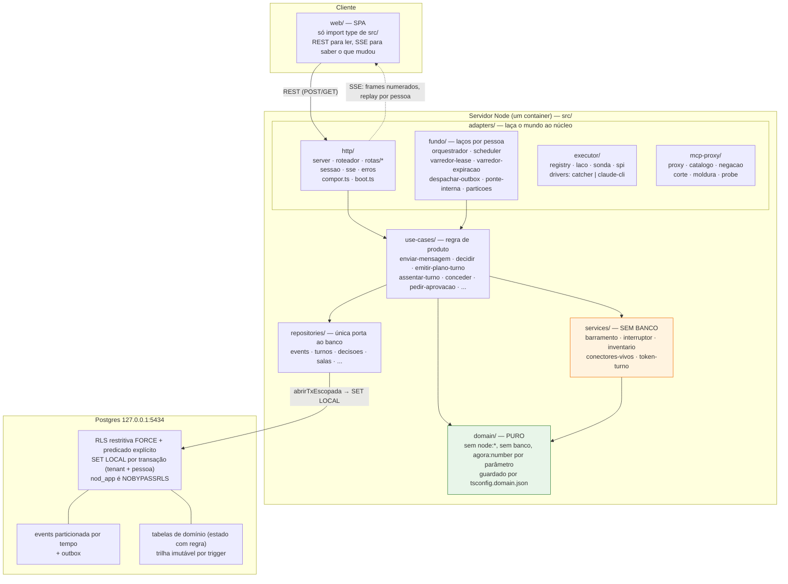
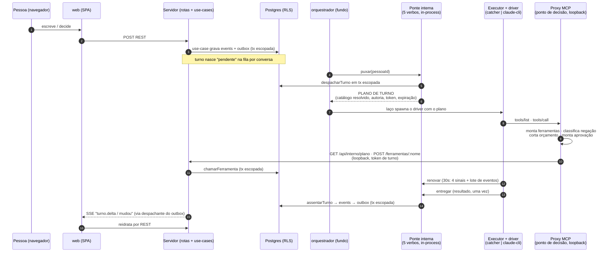
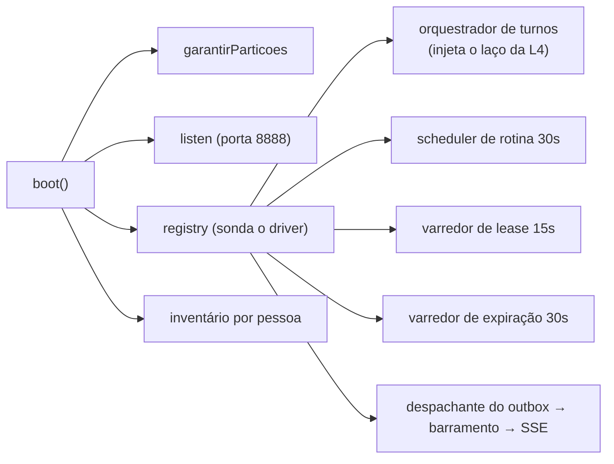

# Arquitetura do nod

Um servidor Node (Postgres com RLS em duas camadas) emite
**planos de turno**; o app local **puxa** o trabalho e roda o CLI do fornecedor atrás de um
**proxy MCP**, que é o ponto de decisão do produto. Fonte: `AGENTS.md`, `docs/adr/`,
`src/adapters/http/compor.ts` e `boot.ts`.

## 1. Camadas e fronteiras travadas pelo código

**Direção de import (eslint) e pureza (compilador) são travas, não convenção:** `domain` não
conhece ninguém; `services` não toca no banco; `repositories` é a única porta ao Postgres; toda
transação carrega tenant **e** pessoa (`abrirTxEscopada`), e ler sem escopo falha fechado no
Postgres.

## 2. Fluxo de um turno — a ponte puxa, o proxy decide

Há **dois canais internos** distintos (verificado no código):
- **Ponte interna** (`src/adapters/fundo/ponte-interna.ts`): os cinco verbos do ADR-021
  (`conectar/desconectar/puxar/renovar/entregar`) hoje são **chamadas de função in-process**, não
  HTTP. O orquestrador é quem os dirige.
- **Rotas internas HTTP** (`/api/interno/*`, `src/adapters/http/rotas/interno.ts`): autenticadas
  pelo **token de turno**, com `Origin → 403` antes do token. É por aqui que o **proxy MCP** volta
  ao servidor: `GET /plano`, `POST /ferramentas/:nome`, `GET /decisoes/:id/aguardar`, `POST /negacoes`.

**Chaves do desenho (todas confirmadas no código):**
- O servidor **nunca disca** para a máquina: presença é o próprio poll (ADR-021). Hoje a ponte é
  `PonteInterna` in-process; a versão HTTP multi-máquina entra sem trocar o driver.
- O **plano de turno** (ADR-024) é o primitivo: sem plano/expirado/catálogo vazio, `tools/list`
  vazio e todo `tools/call` negado (fail-closed estrutural — `proxy.ts`, não código de política).
- O **proxy MCP** (ADR-013) é a autoridade local (loopback) — contém o **agente**, não o dono da
  máquina. Nunca consulta WAN por chamada: decide contra o plano já puxado.
- Dois executores (ADR-014): `catcher` (padrão, in-process, custo zero) e `claude-cli` (haiku real
  com `--strict-mcp-config --tools "" ` e env limpo; custa assinatura).

## 3. Laços de fundo (boot.ts, todos por pessoa)

## 4. Conformidade código × ADR

Verificado contra o código real (não só a doc). Todos **confirmam**; a única nuance é a ponte
(contrato de 5 verbos existe, mas hoje in-process, não HTTP — a própria ADR-021 já registra isso).

| ADR | Afirmação | Estado | Evidência |
|---|---|---|---|
| 003 | `abrirTxEscopada` exige tenant+pessoa, `SET LOCAL` por tx, `escopo_vazio` se vazio | ✅ | `src/db/tx.ts:14-27,41-57` |
| 003 | Só aceita o POOL; tx já aberta → `estado_invalido` | ✅ | `src/db/tx.ts:41-45` |
| 003 | RLS `FORCE` + policies por comando (`nod_pessoa_select/insert/update/delete` + `nod_tenant` restritiva) | ✅ | `src/db/migrations/0004_policies_por_comando.sql:37-70` |
| 003 | `nod_app` é `NOBYPASSRLS`; ler sem escopo falha fechado | ✅ | `infra/postgres/init/01_roles.sql:15` · `tests/conformidade/rls.test.ts:77` |
| 004 | Trilha imutável por trigger (bloqueia UPDATE/DELETE/TRUNCATE) | ✅ | `src/db/migrations/0001_fundacao.sql:115-132` |
| 005/006 | Uma `events` particionada por tempo, sem catch-all; `garantirParticoes` | ✅ | `0001_fundacao.sql:141-163` · `src/adapters/fundo/particoes.ts:30` |
| 005 | Outbox + despachante publica no barramento | ✅ | `0001_fundacao.sql:183-201` · `src/adapters/fundo/despachar-outbox.ts:66-91` |
| 013 | Proxy: monta ferramentas · classifica negação · corta orçamento · monta aprovação | ✅ | `mcp-proxy/{catalogo,negacao,corte,moldura}.ts` |
| 013 | Proxy chama o servidor por loopback in-process, nunca WAN por chamada | ✅ | `mcp-proxy/proxy.ts:99` · `executor/cliente-nod.ts:117-128` |
| 014 | Dois drivers (`catcher` padrão, `claude-cli`); haiku + `--strict-mcp-config --tools ""` + env limpo | ✅ | `compor.ts:125` · `executor/drivers/claude-cli.ts:49-95` |
| 016 | SSE com frames numerados + replay por pessoa | ✅ | `http/sse.ts:20` · `services/barramento.ts:83-120` |
| 018 | Domínio puro (sem `node:*`/banco, `agora:number`); guardado por compilador + fence | ✅ | `tsconfig.domain.json` · `scripts/prove-domain-fence.sh` · `package.json` (`fence:domain`) |
| 021 | 5 verbos `conectar/desconectar/puxar/renovar/entregar`; servidor nunca disca | ✅ (in-process) | `src/adapters/fundo/ponte-interna.ts:66-146` |
| 021 | Rotas `/api/interno/*` com `Origin → 403` antes do token | ✅ | `http/roteador.ts` · `http/rotas/interno.ts:38-50` |
| 023 | Todo evento carrega autor + `sob_procuracao_de` | ✅ | `use-cases/autoria-evento.ts:29-91` · `0001_fundacao.sql:148-157` |
| 024 | `emitirPlanoTurno` (catálogo, autoria, token, expiração); proxy é único consumidor | ✅ | `use-cases/emitir-plano-turno.ts` · `mcp-proxy/proxy.ts:62-150` |

